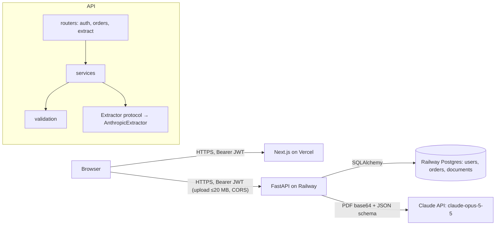

# MVP: GenHealth DME order-intake service

## 1. Approval summary
**Problem and user:** DME intake staff re-key patient and provider details from faxed order PDFs by hand, and one wrong value means a denied claim or a delayed patient.

**MVP outcome:** A user signs up, uploads a faxed order PDF, and gets back a saved order with patient first/last name, DOB, and ordering provider name and NPI extracted. Each value carries its evidence quote. Nothing is guessed: missing or invalid fields are flagged and the order stays `needs_review` until the user fixes them in a review screen with the PDF alongside. Full CRUD over the API and UI, owner-scoped. Live at a public URL.

**Architecture:**
- Web: Next.js 15 (TS, App Router, Tailwind + shadcn/ui) on Vercel, calling the API directly with a bearer JWT
- API: FastAPI (Python 3.12, uv), SQLAlchemy 2 + Alembic, Docker on Railway
- Data: Railway Postgres 16, tables `users`, `orders`, `documents` (PDF as bytea)
- Extraction: Claude `claude-opus-5-5` reads the PDF natively, returns JSON-schema output with value + evidence + page per field, then deterministic validators (grounding, names, DOB, NPI Luhn). The provider is swappable for Bedrock
- Auth: API-owned email/password (argon2id) + 60-min HS256 JWT, every query owner-scoped, other users' records return 404
- Design: prototype https://claude.ai/artifact/SqXMdtrkFR3SBXVDuTwSM5, styled after genhealth.ai's palette and type (no logo or name, disclaimer footer). **Approving this plan signs off the prototype as M4's design source**, so the chain doesn't stop before M4
- Deep docs: `docs/architecture/{architecture,data-schema,api}.md`
- History: one commit per completed task, milestone PRs merged without squash

**Milestones** (each one PR into `feat/order-intake` with a commit per task, built, tested against the running app, merge-committed, then the next)
| # | Issue | Milestone | Proves | Est. lines |
| --- | --- | --- | --- | --- |
| 1 | M1 | scaffold + deploy skeleton | Monorepo boots locally, `/health` green, `make verify` green, Playwright smoke, **API and web already live** on Railway/Vercel | ~450 |
| 2 | M2 | data + auth + CRUD | Register/login, seeded reviewer accounts, Order CRUD persisted, user isolation (404), validators on create/patch | ~650 |
| 3 | M3 | extraction | `POST /orders/extract` on the CPAP fax → saved order, NPI flagged `checksum_failed`, `needs_review`. Eval harness scores benchmark + synthetic set | ~650 |
| 4 | M4 | web workflow UI | Sign up/in, orders list, upload → review/fix → ready, manual create/edit/delete, all states | ~800 |
| 5 | M5 | PDF preview (cut line 14:30) | Review screen renders the stored PDF, and "p.N" evidence chips jump to that page | ~250 |
| 6 | M6 | end-to-end proof + docs | 3 journeys proven headless against the **deployed** app. README, curl walkthrough, How to review | ~200 |

**End-to-end acceptance** (owned by M6, proven in the headless browser against the deployed URL)
- AC-M6.1: Sign up → upload the CPAP fax → order shows Marie / Curie / 1900-12-05 / Arjun Raj… / 9182734556 with a "Fails NPI checksum" error and `needs_review` → correct the NPI to a valid one → Save → `ready`.
- AC-M6.2: (using the two seeded reviewer accounts on the deployed app, or two fresh sign-ups) User B can't see user A's order in the list, and gets "Order not found" in the UI and 404 from the API for A's order and its PDF.
- AC-M6.3: Upload a synthetic PDF with no DOB → DOB is empty with a "Not found in document" error and `needs_review`. No value is invented.

**Size** ~3,000 lines · ~2.4M tokens · 6 milestone PRs + 1 feature-release PR

**Risks:**
1. **Timebox (hard stop 15:13).** About 2h35 of estimated work starts ~13:00. Cut order: M5 preview (cut if not started by 14:30), then the synthetic eval shrinks to 4 cases, then UI polish. At 14:55, whatever is deployed is the submission, and the feature-release PR opens.
2. **Deploy blocked on human logins/keys.** The pre-flight below must be done before launch. Deploy happens in M1, so R5 is de-risked first.
3. **Extraction accuracy on unseen faxes.** Mitigated by native-PDF vision on Opus, the grounding check, "null over guess" prompt rules, and the measured eval.

**Pre-flight (human, before typing approve):**
1. `brew install railway uv`, then `railway login`. (`vercel` and `gh` are already logged in.)
2. Create an Anthropic API key and save it as `ANTHROPIC_API_KEY=…` in `services/api/.env` (gitignored; agents never read it).
3. After M1 creates the Railway project, set `ANTHROPIC_API_KEY` and `SEED_USERS=mahum@genhealth.ai:<pw1>,mike@genhealth.ai:<pw2>` in Railway → API service → Variables (strong passwords you generate, sent in the submission email). The run doesn't wait on this; the M3 and M6 deploy checks report whether they're set.

**Out of scope for the MVP:** NPPES registry check, async extraction, S3, password reset/refresh tokens, extra order fields (HCPCS, diagnoses), BAA vendors and audit log (all in `docs/backlog.md`). Also CI workflows: the local reviewer posts the PR review.

---

## 2. Grill
Full log with every option offered: `docs/process/grill-log.md`. Decisions: `docs/process/decision-log.md`.

| # | Topic | Question | Answer |
| --- | --- | --- | --- |
| 1.1 | Extraction | Approach for unseen PDFs, given HIPAA? | Anthropic API, native PDF, behind a swappable provider interface (after the BAA and cost clarifications) |
| 1.1b | Model | Default model? | Opus 5.5, env-configurable |
| 1.2 | Missing data | Missing or invalid field on upload? | Save as `needs_review` with an issues list |
| 1.3 | Auth | How do users authenticate? | API-owned JWT |
| 1.4 | Hosting | Where? | Vercel + Railway (overrode Render + Neon) |
| 2.1 | Timebox | Has it started? | Yes, at 12:13. Hard stop 15:13 |
| 2.2 | Repo | Visibility and branches? | Public, milestone PRs → `feat/order-intake` → release PR into `main` |
| 2.3 | Frontend | How much? | Review UI + PDF preview |
| 2.4/2.5 | PDF storage | Keep the PDF? | Yes, for the preview (overrode discard) |
| 2.6 | Scope cut | Preview scheduling? | Last feature milestone, cut line 14:30 |
| 2.7 | Eval | Proof of extraction quality? | CPAP fax benchmark + synthetic set |
| 2.8 | Processing | Sync or async? | Sync, with async documented for scale |
| 3.1 | PDF store | Where? | Postgres bytea |
| 3.2 | Bad values | Invalid but present? | Keep as read, flagged |
| 3.3 | NPPES | Registry check? | Backlog, only if time remains |
| 3.4 | E2E proof | Which journeys? | Upload→fix→ready, isolation, missing field |

## 3. Product brief
- **Users and jobs:** DME supplier intake staff turn a faxed order into a correct system record, fast. Reviewers (graders) exercise the API with curl/Swagger and the UI.
- **Core journeys:** (1) upload a PDF → review issues → fix → ready; (2) manual order CRUD; (3) a user's data is private to them.
- **Non-goals:** billing/claims, other order fields, multi-tenant orgs/roles, real PHI, mobile-first UI.
- **Success signal:** on PDFs it has never seen, the service either gets each of the 5 fields right or flags it. It never silently saves a wrong or invented value. Measured by `evals/` as field accuracy and "no-guess" rate.

**Benchmark findings** (`DME Patient Demo Document CPAP.fax.pdf`, 3 pages + 1 blank):
- Expected: Marie / Curie / DOB 12/05/1900 / Arjun Raj D.P.M / NPI 9182734556.
- The NPI fails the Luhn check, so the expected status is `needs_review`.
- Distractors: "Referring Physician: Gregory House MD" (not the ordering provider), fax-header dates, signature date "2/30/24", two different visit dates, a blank page.
- Age 124, so a DOB age rule must warn, not block.

## 4. Architecture
### System

### Stack and why
| Layer | Choice | Why | Rejected |
| --- | --- | --- | --- |
| API | FastAPI + Pydantic v2 | Typed contracts, free OpenAPI/Swagger for graders, async upload handling | Django REST (heavier), Flask (no schema) |
| ORM / migrations | SQLAlchemy 2 + Alembic | Standard, explicit migrations | SQLModel (thinner docs for edge cases) |
| Python tooling | uv, ruff, pytest | Fast, single lockfile | poetry, pip-tools |
| DB | Postgres 16 | JSONB for issues and extraction, bytea for PDFs, Railway-native | SQLite (not shared across deploys) |
| Extraction | Claude Opus 5.5, native PDF | Best on scans and distractors. See the ADR | OCR + LLM, OCR + regex |
| Auth | argon2id + JWT | Curl-testable, no vendor | Clerk, Supabase Auth |
| Web | Next.js 15 + Tailwind + shadcn/ui, pnpm | The human's choice, fast to a finished-looking UI | — |
| API types in web | `openapi-typescript` from `/openapi.json` | No duplicated types | Hand-written types |
| E2E | Playwright | Headless proof against local and deployed | Cypress |
| Hosting | Vercel + Railway | The human's choice, no body limit on the API | Vercel for the API (4.5 MB), Render + Neon |

### Data model
- `users(id uuid pk, email citext unique, password_hash, created_at)`
- `documents(id uuid pk, owner_id fk users, filename, sha256, size_bytes, page_count, content bytea, created_at)`
- `orders(id uuid pk, owner_id fk users idx, document_id fk documents null on delete cascade, status enum(needs_review, ready), patient_first_name, patient_last_name, patient_dob date null, provider_name, provider_npi varchar(10) null, issues jsonb [], extraction jsonb null, created_at, updated_at)`
- `issues[]` = `{field, code, severity: error|warning, message}`. `extraction` = `{model, latency_ms, input_tokens, output_tokens, fields: {<field>: {raw, evidence, page}}, provider_candidates: []}`

### API contract (summary; detail in the M2/M3 plans)
`GET /health` · `POST /auth/register` · `POST /auth/login` · `GET /auth/me` · `GET/POST /orders` · `GET/PATCH/DELETE /orders/{id}` · `POST /orders/extract` (multipart `file`) · `GET /orders/{id}/document`

### Conventions
- Layout: `apps/web/`, `services/api/{app/{routers,services,models,schemas,validation,extraction},alembic,tests}`, `evals/` (cases + `run_eval.py`), `e2e/` (Playwright), `docs/`, `Makefile`, `docker-compose.yml`.
- Run locally (→ `.claude/project.json` app):
  - setup: `docker compose up -d --wait`, `make migrate`
  - start: `make dev` (API :8000, web :3000)
  - health: `http://localhost:8000/health`, `http://localhost:3000/`
  - stop: `docker compose down`
- Verify: `make verify` = ruff check + ruff format --check + pytest (API) + tsc + eslint (web).
- Tests: API unit/integration in `services/api/tests` (pytest against compose Postgres, Claude mocked via a fake `Extractor`). E2E in `e2e/` (Playwright). Extraction evals in `evals/`, which call live Claude and are run on demand, not in verify.
- Commits: one conventional commit per completed task (each milestone plan lists its tasks), so `git log` shows the work step by step. Milestone PRs merge into `feat/order-intake` with **merge commits, not squash**, so the task history reaches `main`.
- Deep docs: `docs/architecture/architecture.md`, `data-schema.md`, `api.md`. UI design source: the prototype artifact + `docs/context/designs/`.
- Secrets: `.env` files gitignored, `.env.example` committed. Logs never contain field values.

### ADRs
In `docs/context/decisions/`:
- `2026-11-04-monorepo-layout.md`
- `2026-11-04-extraction-claude-native-pdf.md`
- `2026-11-04-validation-needs-review.md`
- `2026-11-04-auth-api-jwt.md`
- `2026-11-04-hosting-vercel-railway.md`
- `2026-11-04-pdf-storage-postgres.md`
- `2026-11-04-sync-extraction.md` (includes the async scaling design)
- `2026-11-04-hipaa-posture.md`
- `2026-11-04-frontend-direct-api.md`

Design: `docs/context/designs/ui.md`. Backlog: `docs/backlog.md`.

## 5. Milestone plans
- `.claude/plans/mvp-order-intake/m1-scaffold.md`
- `.claude/plans/mvp-order-intake/m2-data-auth.md`
- `.claude/plans/mvp-order-intake/m3-extraction.md`
- `.claude/plans/mvp-order-intake/m4-web-ui.md`
- `.claude/plans/mvp-order-intake/m5-pdf-preview.md`
- `.claude/plans/mvp-order-intake/m6-e2e-docs.md`
