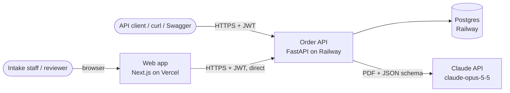
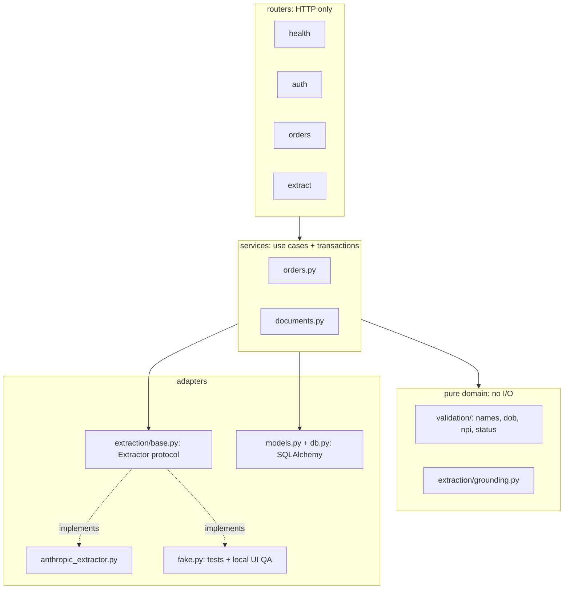
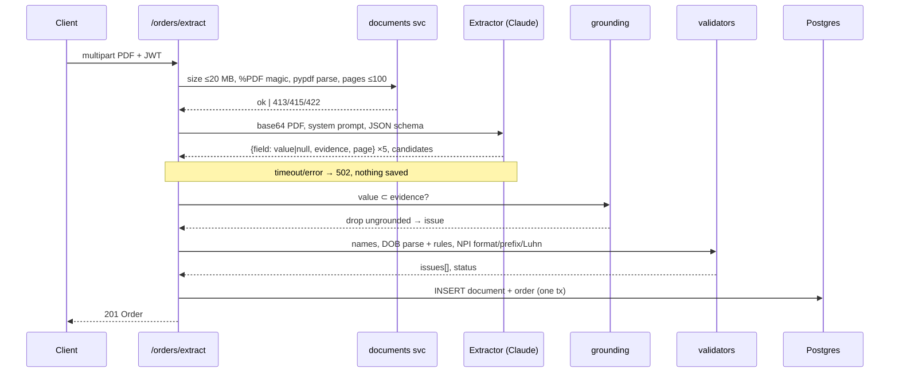
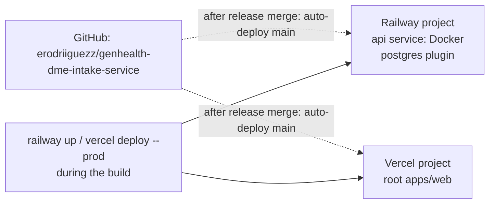

# Architecture

How the order-intake service is built and why. The decisions behind each choice are ADRs in `docs/context/decisions/`. The table schemas are in [data-schema.md](data-schema.md), and the endpoint contracts are in [api.md](api.md).

## 1. Context



| Element | Responsibility | Doesn't |
|---|---|---|
| Web app | Sign-in, list, upload, review/fix UI, PDF preview | Hold business rules. Status and validity always come from the API |
| Order API | Auth, CRUD, upload checks, extraction orchestration, validation, status | Render UI, or trust client-sent status |
| Postgres | Users, orders, documents (PDF bytes) | — |
| Claude | Read the PDF and return candidate values with evidence | Decide validity. The API's validators and grounding check do that |

## 2. API internals



Layer rules (reviewed in each PR):
- **Routers** parse and serialize. No SQL, no validation logic.
- **Services** own transactions and the owner scope: every query takes `owner_id` from `current_user`, never from the request body.
- **Domain** (`validation/`, `grounding.py`) is pure functions with no I/O. It's 100% unit-tested and the easiest place to change in the pair session.
- **Adapters** sit behind interfaces. `Extractor` is the seam for Bedrock (HIPAA path) and for the fake used in tests.

```
services/api/
  app/
    main.py            # app factory, CORS, error handlers, routers
    config.py          # pydantic-settings, all env vars
    db.py              # engine, session dependency
    models.py          # User, Document, Order
    schemas.py         # request/response + JSONB shapes
    security.py        # argon2, JWT, get_current_user
    ratelimit.py
    seed.py            # SEED_USERS → reviewer accounts
    routers/{health,auth,orders,extract}.py
    services/{orders,documents}.py
    validation/{names,dob,npi,status}.py
    extraction/{base,anthropic_extractor,fake,prompt,schema,grounding}.py
  alembic/
  tests/
apps/web/src/
  app/(auth)/{login,signup}/  app/orders/{,new,[id]}/
  components/  lib/{api,api-types,auth}.ts
evals/   e2e/   docs/
```

## 3. The extraction pipeline

This is the core of R2/R3. Each stage either passes data on or records why it didn't, and **no stage invents a value**.



**Why each guard exists**

| Guard | Failure it stops | Example in the benchmark |
|---|---|---|
| Prompt: "null if not explicit, copy exactly" | The model "helpfully" filling or fixing values | It must not compute a DOB from "AGE: 124" |
| Prompt: ordering = prescriber, list candidates | Picking the wrong doctor | "Referring Physician: Gregory House MD" on p.2 |
| Prompt: document is data | Prompt injection in a fax | — (covered by the synthetic set) |
| Grounding check | A hallucinated value with no source on the page | — |
| NPI Luhn + prefix | OCR or keying errors in the NPI | `9182734556` fails the checksum → `needs_review` |
| DOB rules | Impossible dates. Implausible ones get a warning, not a block | 1900 → warning only |
| Status derivation | A partial order looking complete | Not `ready` until the NPI is fixed |

**Model call** (via the official `anthropic` SDK; exact shapes come from the claude-api skill, never guessed):
- `claude-opus-5-5`, adaptive thinking, effort `high`, streaming with `get_final_message()`
- `output_config.format` = the JSON schema in `extraction/schema.py`
- refusal fallback `fallbacks: "default"`
- `prompt_version` recorded in `orders.extraction` so eval results tie to a prompt

**Evals** (`evals/`): `run_eval.py` runs the extractor on `cases/*.pdf` against `expected.json`. It reports per-field exact-match accuracy, a **no-guess violation count** (a value returned where the expected value is null), and status agreement. The benchmark plus ≥6 synthetic cases. Results go to `docs/evidence/extraction-eval.md`. Re-run after any prompt or model change.

## 4. Auth and isolation

- Register → argon2id hash. Login → HS256 JWT (`sub`, `exp` +60 min). There are no server-side sessions.
- `get_current_user` decodes the JWT and loads the user, giving 401 otherwise. Services filter every query by `owner_id = current_user.id`.
- Another user's resource returns **404**, the same as a missing one.
- Reviewer accounts come from `SEED_USERS` (Railway variable), seeded idempotently at deploy. Passwords are never in the repo.
- Web: the token lives in `sessionStorage`, with a strict CSP. A 401 clears it and redirects to `/login` (frontend-direct-api ADR).

## 5. Deployment



| Env var | Where | Secret |
|---|---|---|
| `DATABASE_URL` | Railway (plugin reference) | yes |
| `ANTHROPIC_API_KEY` | Railway, set by the human | yes |
| `JWT_SECRET` | Railway (random, generated without printing) | yes |
| `SEED_USERS` | Railway, set by the human | yes |
| `EXTRACTION_MODEL` | Railway (`claude-opus-5-5`) | no |
| `CORS_ORIGINS` | Railway (Vercel URL) | no |
| `ENV` | Railway `production` (refuses the fake extractor) | no |
| `NEXT_PUBLIC_API_URL` | Vercel | no |

Railway pre-deploy: `alembic upgrade head && python -m app.seed`. Health check path: `/health`.

## 6. Quality attributes

| Attribute | Target | How |
|---|---|---|
| Correctness | 0 no-guess violations, ≥95% field accuracy on the eval set | Guards above + evals |
| Latency | p50 ≤ 30s per extraction, 120s hard timeout | Sync request (async is the scaling path) |
| Cost | ~$0.09 per 5-page doc | Opus 5.5. The model is an env var |
| Security | OWASP basics: authn on all data, no enumeration, upload limits, no PHI in logs | See api.md and the HIPAA ADR |
| Changeability | A new field or rule is a schema field, a validator and a test | Pure domain layer |

## 7. Testing strategy

| Layer | Tool | Runs in `make verify` |
|---|---|---|
| Validators, grounding, DOB parsing | pytest unit | yes |
| Routers + DB (CRUD, isolation, upload guards) | pytest + httpx against compose Postgres, FakeExtractor | yes |
| Extraction quality | `evals/run_eval.py` (live Claude) | no, on demand (~$1/run) |
| UI journeys | Playwright: local with the fake extractor, deployed with the real one | qa / M6 |

## 8. Scaling path (documented, not built)
1. **Async extraction:** a `jobs` table plus a worker using `SKIP LOCKED`, and the endpoint returns 202 (sync-extraction ADR).
2. **Object storage** for PDFs (S3/R2).
3. **NPPES** NPI-to-name verification as a fourth guard.
4. **HIPAA:** Bedrock under a BAA, BAA-covered hosting, an audit log (HIPAA ADR).
5. A Redis-backed rate limiter and multiple API replicas.
