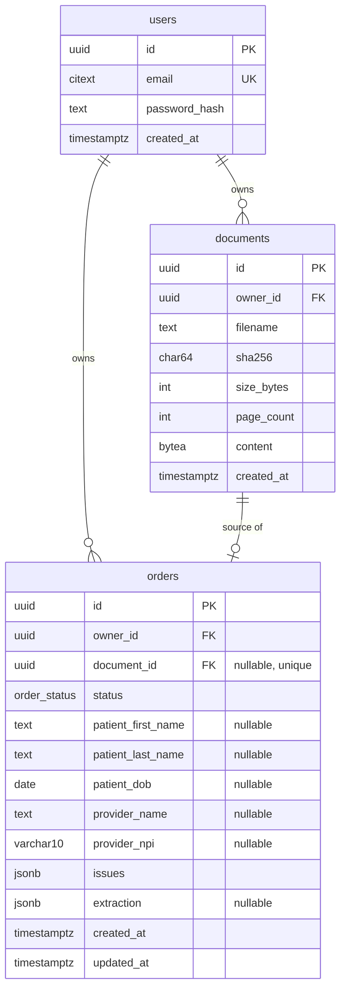

# Data schema

Postgres 16. **Full reviewable DDL: [schema.sql](schema.sql)**, which was applied and constraint-tested on postgres:16 on 2026-11-04. The schema is owned by Alembic (`services/api/alembic/versions/`), and this doc is the design those migrations implement. If the two disagree, the migration wins and this doc gets fixed in the same PR.

## Entity relationships



## Tables

### `users`
| Column | Type | Null | Default | Notes |
|---|---|---|---|---|
| `id` | `uuid` | no | `gen_random_uuid()` | PK |
| `email` | `citext` | no | — | Unique. Case-insensitive, so `Mike@GenHealth.ai` = `mike@genhealth.ai`. Stored trimmed |
| `password_hash` | `text` | no | — | argon2id (`argon2-cffi` defaults: t=3, m=64 MiB, p=4). Never returned and never logged |
| `created_at` | `timestamptz` | no | `now()` | |

Needs the `citext` extension, created in migration 0001 (`CREATE EXTENSION IF NOT EXISTS citext`).

### `documents`
| Column | Type | Null | Default | Notes |
|---|---|---|---|---|
| `id` | `uuid` | no | `gen_random_uuid()` | PK |
| `owner_id` | `uuid` | no | — | FK → `users.id` `ON DELETE CASCADE` |
| `filename` | `text` | no | — | Client filename, sanitized (path stripped, ≤255 chars). Display only |
| `sha256` | `char(64)` | no | — | Hex digest of `content`. Used for dedupe hints, not uniqueness |
| `size_bytes` | `integer` | no | — | `CHECK (size_bytes > 0 AND size_bytes <= 20971520)` (20 MB) |
| `page_count` | `integer` | no | — | From `pypdf`. `CHECK (page_count BETWEEN 1 AND 100)` |
| `content` | `bytea` | no | — | The PDF bytes. **Never selected in list queries** (`deferred()` in SQLAlchemy) |
| `created_at` | `timestamptz` | no | `now()` | |

### `orders`
| Column | Type | Null | Default | Notes |
|---|---|---|---|---|
| `id` | `uuid` | no | `gen_random_uuid()` | PK |
| `owner_id` | `uuid` | no | — | FK → `users.id` `ON DELETE CASCADE` |
| `document_id` | `uuid` | yes | — | **Composite FK** `(document_id, owner_id)` → `documents(id, owner_id)` `ON DELETE CASCADE`, so an order can only reference its own owner's document. **Unique** (one order per document). Null for manual orders |
| `status` | `order_status` enum | no | `'needs_review'` | `needs_review` \| `ready`. **Derived server-side, never client-settable** |
| `patient_first_name` | `text` | yes | — | As read or as edited. ≤100 chars |
| `patient_last_name` | `text` | yes | — | ≤100 chars |
| `patient_dob` | `date` | yes | — | Null when missing **or unparseable**. The raw string is kept in `extraction.fields.patient_dob.raw` |
| `provider_name` | `text` | yes | — | As printed, credentials included (e.g. `Arjun Raj D.P.M`). ≤150 chars |
| `provider_npi` | `varchar(20)` | yes | — | Spaces, dashes and dots stripped, nothing else changed. **Stored even when it's the wrong length or fails the checksum** (D16). A `varchar(10)` would reject the very values the validators should flag |
| `issues` | `jsonb` | no | `'[]'` | Current validation results (schema below). Recomputed on every write |
| `extraction` | `jsonb` | yes | — | Provenance from the extractor (schema below). Null for manual orders. **Immutable after creation** |
| `created_at` | `timestamptz` | no | `now()` | |
| `updated_at` | `timestamptz` | no | `now()` | Set by the ORM on update |

Deleting an order deletes its document in the same transaction (service layer). Deleting a document cascades to its order.

**DB-level guards** (defense in depth, all in `schema.sql`):
- `orders_ready_complete_chk`: `status = 'ready'` is impossible unless all 5 fields are non-null and `issues` has no `severity = error`.
- `orders_document_owner_fk`: cross-user document links are impossible.
- Shape checks: `issues` is an array, `extraction` is an object (and only with a document), name, NPI and filename lengths, sha256 hex, size ≤ 20 MB, pages 1–100, `octet_length(content) = size_bytes`.
- `updated_at` is set by trigger.
- No CHECK rejects a value the validators would only flag (D16).

### Indexes
| Index | Why |
|---|---|
| `orders (owner_id, created_at DESC)` | The list endpoint: newest first, per owner |
| `orders (owner_id, status)` | Status filter |
| `orders (document_id)` UNIQUE | Enforces one order per document |
| `documents (id, owner_id)` UNIQUE | Target of the composite owner FK |
| `documents (owner_id)` | Owner-scoped lookups and cascade |
| `users (email)` UNIQUE | Login |

## JSONB shapes

Pydantic models in `app/schemas.py` validate these on write. The DB doesn't enforce them.

### `orders.issues[]`
```json
[
  {
    "field": "provider_npi",
    "code": "npi.checksum_failed",
    "severity": "error",
    "message": "Fails the NPI checksum. This isn't a valid NPI as written.",
    "source": "validation"
  },
  {
    "field": "patient_dob",
    "code": "dob.age_over_120",
    "severity": "warning",
    "message": "Patient would be 124 years old. Check the date.",
    "source": "validation"
  }
]
```
- `field`: one of `patient_first_name | patient_last_name | patient_dob | provider_name | provider_npi`.
- `severity`: `error` blocks `ready`. `warning` is shown and doesn't block.
- `source`: `validation` (recomputed every write) or `extraction` (`ungrounded`, `multiple_candidates`, kept until the user edits that field).

### Issue codes
| Code | Severity | Source | Trigger |
|---|---|---|---|
| `<field>.not_found` | error | validation | Value is null |
| `<field>.ungrounded` | error | extraction | The extractor returned a value its evidence quote doesn't contain. The value is dropped |
| `name.invalid_chars` | error | validation | Digits or disallowed symbols in a name |
| `name.too_long` | error | validation | Over 100 chars (150 for a provider) |
| `dob.unparseable` | error | validation | The raw DOB couldn't be parsed as a date |
| `dob.in_future` | error | validation | DOB after today |
| `dob.too_old` | error | validation | DOB before 1900-01-01 |
| `dob.age_over_120` | warning | validation | Age over 120 |
| `npi.format` | error | validation | Not exactly 10 digits |
| `npi.prefix` | error | validation | First digit isn't 1 or 2 |
| `npi.checksum_failed` | error | validation | Luhn over `80840` + the first 9 digits doesn't match the 10th |
| `provider.multiple_candidates` | warning | extraction | The document names more than one provider (e.g. a referring physician) |

### `orders.extraction`
```json
{
  "provider": "anthropic",
  "model": "claude-opus-5-5",
  "prompt_version": "2026-11-04.1",
  "latency_ms": 18432,
  "input_tokens": 9120,
  "output_tokens": 640,
  "fields": {
    "patient_first_name": { "raw": "Marie", "evidence": "Marie Curie", "page": 1, "grounded": true },
    "patient_last_name":  { "raw": "Curie", "evidence": "Marie Curie", "page": 1, "grounded": true },
    "patient_dob":        { "raw": "12/05/1900", "evidence": "Patient Date of Birth 12/05/1900", "page": 1, "grounded": true },
    "provider_name":      { "raw": "Arjun Raj D.P.M", "evidence": "Prescriber Name and Address Arjun Raj D.P.M", "page": 1, "grounded": true },
    "provider_npi":       { "raw": "9182734556", "evidence": "Prescriber NPI: 9182734556", "page": 1, "grounded": true }
  },
  "provider_candidates": [
    { "name": "Arjun Raj D.P.M", "role": "prescriber", "npi": "9182734556", "page": 1 },
    { "name": "Gregory House MD", "role": "referring physician", "npi": null, "page": 2 }
  ],
  "notes": null
}
```
`raw` is exactly what the model returned, before parsing. It's kept so a reviewer can see what was read even after a user edits the field.

## Status derivation
```
status = ready  iff  all 5 fields are non-null
                AND  no issue with severity = error
else needs_review
```
`app/validation/status.py` implements this as a pure function, and it runs on create, extract and every PATCH. Nothing else writes `status`.

## Data handling
| Data | Where | Retention | Access |
|---|---|---|---|
| Passwords | argon2id hash only | Account lifetime | Never readable |
| Order fields, issues, extraction | `orders` | Until the order is deleted | Owner only |
| PDF bytes | `documents.content` | Until the order is deleted | Owner only, via `GET /orders/{id}/document` |
| Logs | Railway | Platform default | IDs, codes, latency. **Never field values or PDF content.** IntegrityError is logged by constraint name only, with DB `log_error_verbosity = terse` |

## Scaling notes (not built)
- PDFs move to S3 with signed URLs, keeping `documents.storage_key` instead of `content` (backlog B3).
- An async worker adds `status` values `processing` and `failed` and a `jobs` table (backlog B2, see the sync-extraction ADR).
